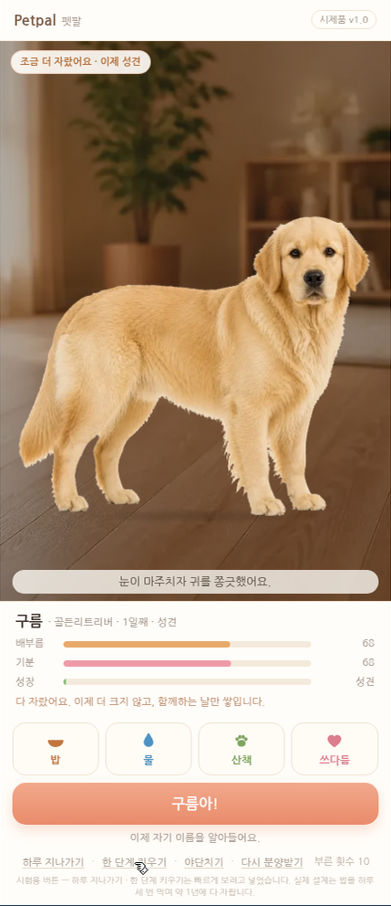

# 펫팔(Petpal) — 오늘 밤 마무리한 v1.0

보고 싶은 마음을 매일의 돌봄으로. 갓 태어난 새끼를 분양받아 **이름을 불러 주고, 밥을 먹이고, 약 1년 동안 자라나는** 웹앱 시제품입니다.
빌드 도구 없이 `index.html` 하나만 더블클릭하면 열립니다. 인터넷·계정·결제 없이 이 브라우저에만 저장됩니다.

```
index.html  ← 더블클릭
```



---

## 아침에 형님이 정하실 5가지 (지금은 이렇게 해 두었습니다)

| # | 정할 것 | 지금 기본값 | 바꾸는 방법 |
|---|---|---|---|
| ① | 강아지 먼저 vs 고양이 함께 | **함께** (강아지 1 · 고양이 1) | `app.js` 맨 위 `CONFIG.maxBreeds` — 1이면 강아지만 열립니다 |
| ② | 시작 품종 수 | **2종** 실제 분양 + 4종 '준비 중' 표시 | `app.js`의 `BREEDS` 목록에서 `ready: true`인 품종 수. 사진이 있어야 열립니다 |
| ③ | 분양 무료·1인 1마리 | **무료 · 브라우저 한 개에 한 마리** | 지금은 저장 구조상 한 마리입니다. 계정·서버를 붙이면 여러 마리로 늘어납니다 |
| ④ | 성장 기간 | **실제 365일** (하루 3끼 × 365일 = 다 자람) | `CONFIG.growthDays` — 30으로 바꾸면 한 달, 90이면 석 달에 다 큰다 |
| ⑤ | 대화 기능 | **꺼 둠** (자리만 만들어 둠) | `talk.js`에 AI 호출을 넣고 `CONFIG.talk.enabled = true` — `talk.js` 안에 예시와 주의사항이 적혀 있습니다 |

이름을 알아듣기까지 부르는 횟수(`CONFIG.callsToLearn`, 기본 10회)도 같은 자리에서 10~20 사이로 바꿀 수 있습니다.

---

## 형님이 말로 정해 주신 네 가지가 실제로 이렇게 들어가 있습니다

1. **아무것도 모르는 애가 이름을 알아가는 것** — 부르면 1~2번은 고개도 들지 않고, 3번째부터 갸웃하고, **10번째에 처음으로 알아듣습니다**(그때 하트가 터지고 달려옵니다). 그 뒤로는 부를 때마다 좋아합니다.
   세어 보기: 화면 아래 `부른 횟수` 표시. → [06-이름-알아들음](스크린샷/06-이름-알아들음.png)
2. **벌 대신 서운함** — `야단치기`를 눌러도 화내지 않습니다. 고개를 떨구고 앉아 서운해하고, 몸빛이 조금 죽습니다. 밥을 오래 안 주면 저절로 서운해합니다. → [07-서운함](스크린샷/07-서운함.png)
3. **1년 성장** — 하루 세 끼까지만 성장에 반영됩니다. 밥을 잘 먹으면 새끼 → 어린 개/고양이 → 성견/성묘로 자라고, **하루 반나절 넘게 굶으면 성장이 멈추고 몸이 마릅니다**. 다 자란 뒤에는 더 자라지 않습니다.
   → [02-골든-아기](스크린샷/02-골든-아기.png) · [04-골든-어린개](스크린샷/04-골든-어린개.png) · [05-골든-성견](스크린샷/05-골든-성견.png)
4. **품종별 분양, 생김새가 다름** — 골든리트리버와 코리안 숏헤어(치즈) 두 아이를 지금 키울 수 있습니다. 같은 아이가 단계마다 다른 사진으로 자라므로, 새끼 때는 몽글몽글하다가 자라면서 품종의 형태가 드러납니다. 고양이는 `산책` 대신 `놀이`입니다.
   → [08-고양이-아기](스크린샷/08-고양이-아기.png) · [09-고양이-성묘](스크린샷/09-고양이-성묘.png)

---

## 화면에서 되는 것

| 화면 | 내용 |
|---|---|
| 분양 | 품종 고르기 → 새끼 미리보기 → 이름 짓기(한글·영문 2~8자) |
| 키우기 | 아이가 방 안에 서 있고, 부르기·밥·물·산책(고양이는 놀이)·쓰다듬 |
| 상태 | 배부름·기분·성장 수치, 함께한 날수·단계 |
| 시험용 버튼 | `하루 지나가기` `한 단계 키우기` `야단치기` `다시 분양받기` |
| 저장 | 새로고침해도 이어짐 (이 브라우저의 localStorage) |

아이는 숨쉬듯 아주 조금씩 움직이고, 부르면(알아들은 뒤) 한 번 뛰고, 산책할 때는 몸을 앞뒤로 흔들며 걷습니다. 화면을 한 번 누르면 쓰다듬은 것이 됩니다.

**바탕이 되는 감정**: 닫아 두었던 시간도 흐릅니다. 오랜만에 열면 "3일 만이네요" 하고, 배고프면 밥그릇을 보고, 기분이 가라앉으면 조용히 앉아 있습니다.

---

## 3D는 메인에서 내렸습니다

지난 v0.3은 사진에 깊이 지도를 입혀 three.js로 세우는 방식이었는데, 형님이 보시고 "캐릭터 모습이 이상하다"고 하신 그 모습입니다. 오늘 밤 안에 자연스럽게 고칠 수 없다고 판단해 **메인은 잘라 낸 사진(2D)으로 두고, 3D 시도는 `experiment-3d/` 폴더에 그대로 보관**했습니다.

- `experiment-3d/index.html` — 그 판을 열어 볼 수 있습니다(같은 방식으로 더 만져 볼 수는 있습니다).
- [10-3D-실험판](스크린샷/10-3D-실험판.png) — 지금 3D 판이 어떻게 보이는지.

**왜 2D로 정했나**: 사진 속 아이는 진짜 새끼·성견처럼 보이지만, 3D 판은 그 사진을 볼록하게 밀어낸 것이라 얼굴과 다리가 납작하게 늘어나 보였습니다. 2D는 그 문제가 없고, 폰에서도 훨씬 가볍습니다(사진 24장 + 배경 1장, 합계 약 1MB).

---

## 폴더 안내

```
index.html · style.css · app.js   ← 지금 앱 (이 세 파일 + talk.js + assets)
talk.js            대화 기능 자리 (기본 꺼짐)
assets/pets/       아이 사진 24장(품종 2 × 단계 3 × 자세 4) + 분양 카드 썸네일 6장
assets/backdrop.webp  방 배경
assets/3d/         experiment-3d 판이 쓰는 사진 묶음
experiment-3d/     3D 시도판 (three.js 포함, lib/)
스크린샷/          지금 앱으로 실제 찍은 화면 10장
archive/           지난 판들(v0.1, v0.2), ChatGPT가 만든 판(app-2-chatgpt.js·old-*.html/css),
                   이번에 갈아엎기 전 백업, GPT에 넣었던 프롬프트
```

---

## 지금 되는 것 / 아직 안 되는 것

**되는 것**
- 분양 → 이름 → 돌봄 → 성장 → 서운함 → 저장까지 한 흐름이 끊기지 않고 돕니다.
- 사진 4가지 자세(서기·앉기·걷기·서운함)가 상태에 따라 바뀝니다.
- 골든리트리버·코리안 숏헤어 두 품종, 세 단계.

**안 되는 것 (정직하게)**
- **표정이 사진이라 눈 깜빡임·입 모양 변화가 없습니다.** 기분은 자세·색으로만 보입니다.
- **걷기가 제자리 흔들기**입니다. 방 안을 실제로 가로지르지 않습니다.
- **2D라서 좌우로 돌려 볼 수 없습니다**(3D 판에 있던 기능).
- 밥 먹는 자세는 '고개 숙인' 사진을 같이 씁니다.
- 소리(멍멍·야옹), 알림, 여러 마리 키우기, 계정·서버 저장은 없습니다.
- 손님에게 보여 줄 실제 서비스가 아닙니다. **시제품**입니다.

---

## 확인한 것 / 확인하지 못한 것

**확인함** — 이 저장소를 원격 브라우저(크롬)로 열어
분양(두 품종) → 이름 짓기 → 골든 세 단계 → 밥 먹기 → 이름 10번째에 알아듣기 → 야단쳤을 때 서운함 → 하루 지나가기(굶주림) → 고양이 분양·세 단계 → 새로고침 후 이어짐까지 직접 눌러 보았습니다.
화면은 커밋 `b2e02d0`에서 찍었고(그 뒤 커밋은 이름 검증·README·문구만 바뀌었습니다), 앱이 직접 표시하는 오류 줄(`errBar`)은 한 번도 뜨지 않았습니다.

**확인하지 못함**
- **형님 PC에서 파일을 더블클릭해 여는 방식.** 원격 브라우저는 `file://` 주소를 열 수 없어, 같은 파일을 웹 주소로 열어 확인했습니다. 바깥 요청이 없고 사진도 저장소 안에 있어 열려야 하지만, 직접 열어 본 것은 아닙니다. 안 열리면 알려 주세요.
- 실제 폰에서의 속도(사진 1MB, 폰에서도 가볍게 만들었지만 실측은 못 했습니다).
- 여러 사람이 각자 키울 때의 서버 저장(계정·서버가 없는 시제품입니다).

---

## 다음에 정할 것

1. **3D를 계속할지** — 지금 2D 사진 방식으로 품종을 늘릴지(품종당 사진 12장+α), 진짜 3D 모델을 사서 갈지.
2. **품종 순서** — 푸들·진돗개·시바·러시안 블루 중 무엇부터.
3. **성장 단계를 3개로 둘지 5개로 늘릴지.**
4. **성장 기간** — 1년 vs 압축(2~3개월). 지금은 1년, `CONFIG.growthDays`로 바로 바꿀 수 있습니다.
5. **대화 기능** — `talk.js` 자리에 넣을 AI와 말투(한두 마디 아기 말투를 권합니다).
